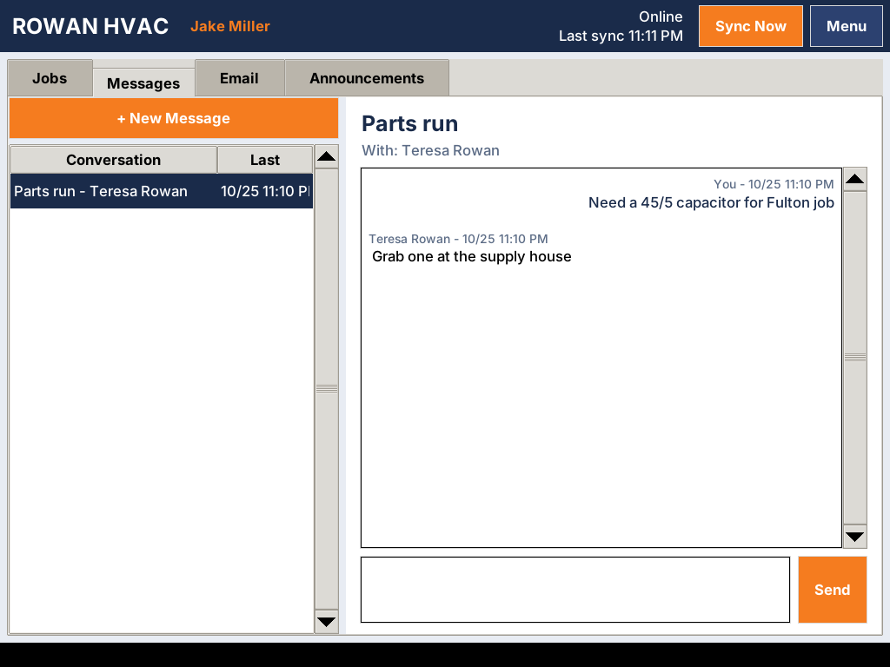
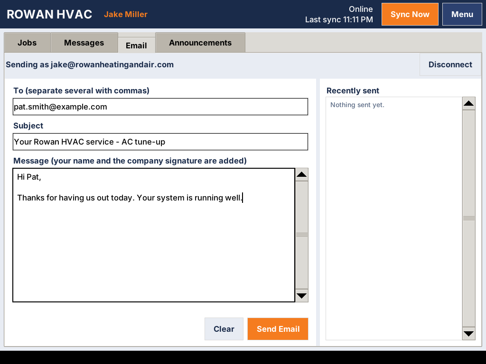
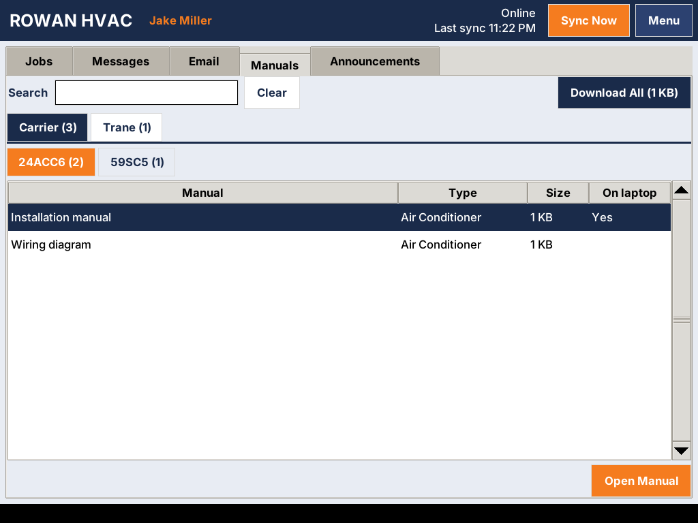
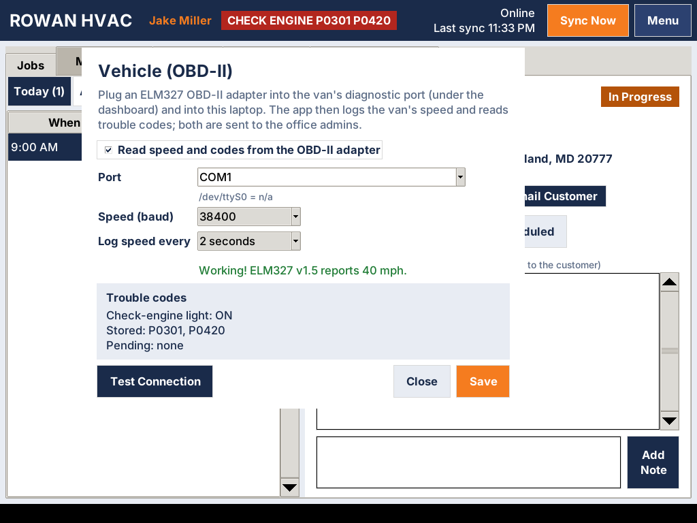
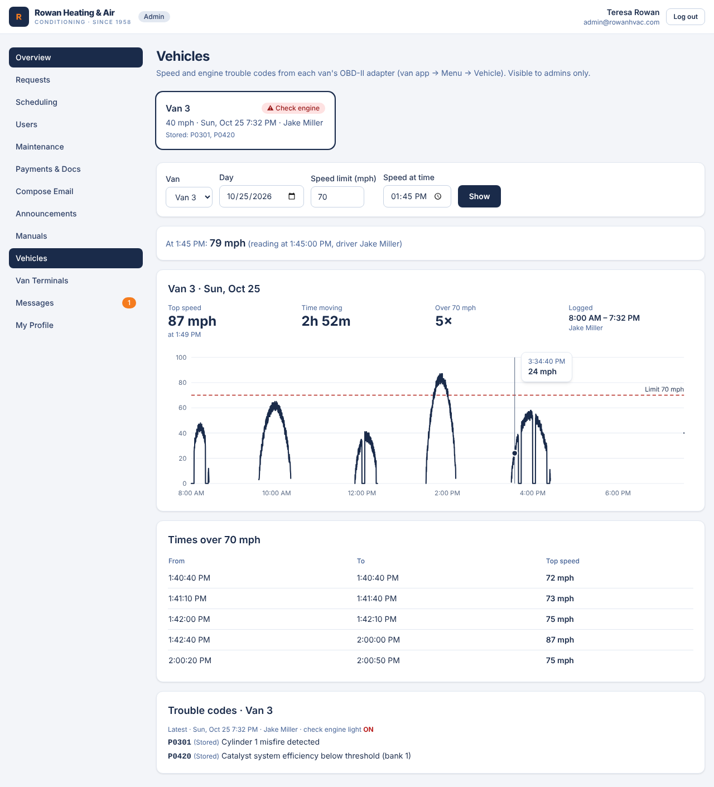

# Rowan Van — desktop app for the van Toughbooks

A desktop app for the technicians' **Panasonic Toughbook CF-29** laptops. It
keeps a local copy of each tech's jobs, so it **works with no signal**, and
syncs with the portal on the Plesk server whenever it can. Every van, plus the
office using the web portal, sees the same jobs, statuses, and notes.


| Messages | Email |
| --- | --- |
|  |  |

| Manuals | Vehicle (OBD-II) |
| --- | --- |
|  |  |

## What a tech can do

- See their jobs: **Today**, **All Open**, **Upcoming**, **Done**
- Open a job: customer, address, phone, email, service needed, appointment time
- **Start Job**, then **Complete Job…** (with the work summary the customer sees
  in their portal history), or go **Back to Scheduled**
- Add **job notes** (internal, never shown to customers)
- **Messages**: the same conversations as the portal's Messages page. Reply,
  or tap **+ New Message** to write to the office, another tech, or a customer.
  Unread messages show on the tab, e.g. **Messages (2)**.
- **Email**: send email **as yourself, from your company mailbox** (the one you
  use in Roundcube at webmail.rowanheatingandair.com). Each sent email also
  appears in your webmail **Sent** folder. On a job, **Email Customer**
  pre-fills the customer's address.
- **Manuals**: equipment manuals organized in **brand tabs**, then **model
  tabs** (e.g. Carrier → 24ACC6). Tap **Open Manual** to view it; once opened,
  it stays on the laptop and works with no signal. **Download All** saves the
  whole library (best on shop Wi-Fi).
- **Vehicle (OBD-II)**: with an OBD-II adapter plugged in, the van's speed is
  logged and its engine trouble codes are read. Both go to the office admins.
  The header shows the live speed, or **CHECK ENGINE** with the codes.
- Read company **announcements**

Changes save instantly on the laptop. The header shows **Online / OFFLINE**,
when it last synced, and how many changes are still waiting to send. Changes go
up the moment there's a connection (it checks every 60 seconds, or tap
**Sync Now**).

## How sync works

```
 Toughbook (van 1) ─┐                         ┌─ Office (web portal)
 Toughbook (van 2) ─┼──HTTPS──► Plesk server ◄┤
 Toughbook (van 3) ─┘        (portal + MySQL) └─ Clients (web portal)
```

- The **server is the single source of truth.** Vans never talk to each other
  directly. They sync through the portal, so a change from van 1 reaches van 2
  and the office within about a minute.
- Each sync is one small HTTPS request (`POST /api/van/v1/sync`): the van sends
  its queued changes and gets the tech's current jobs back. If nothing changed,
  the reply is a few hundred bytes, which is easy on a cellular plan.
- Every change is safe to resend after a dropped connection; nothing is
  duplicated.
- **Conflicts:** if the office cancels a job while the van was offline, the
  tech's status change for it is refused, and an orange banner tells them why.
  Notes written in the field are always kept.
- Jobs reassigned to another tech disappear from the old tech's van on the next
  sync.
- Messages and emails written with no signal are queued, marked **(not sent
  yet)** or **Waiting to send**, and go out automatically.

## Equipment manuals

**Office:** Portal → **Manuals** → *Upload a manual*. Enter the **brand** and
**model number**, pick the equipment type (air conditioner, furnace, heat
pump…), add an optional title ("Installation manual", "Wiring diagram"), and
choose the PDF (or a photo/scan), up to 50 MB.

- Brands and models become **tabs** automatically. Type a new brand or model
  to create its tab; uploading while viewing a tab pre-fills it.
  Capitalization doesn't matter ("carrier" goes into "Carrier").
- A model can have several manuals (installation, service, wiring, parts).
- Techs can also open manuals in the portal. Customers can't see them.
- Deleting a manual removes it from every van on its next sync.

**In the van:** the manual list comes down with every sync (a few KB); the
files are only downloaded when a tech opens one or taps **Download All**. Each
download is checked (SHA-256), so a dropped connection never leaves a broken
file. Opening needs a PDF reader on the laptop. On Windows XP install
**Adobe Reader XI** or **Foxit Reader** (the last versions that support XP).

## Vehicle speed and trouble codes (OBD-II)

**What you need:** an **ELM327 OBD-II adapter** (about $15–30) for each van.

- **Best for the CF-29: the RS-232 (serial cable) kind.** The CF-29 has a real
  serial port (COM1) on the back, so there are no drivers to install and nothing
  to pair.
- USB adapters work too (install the adapter's USB-serial driver; it shows up
  as COM3/COM4…). Bluetooth adapters work once paired (Windows creates a COM
  port for them).
- Plug the adapter into the van's OBD-II port, under the dashboard near the
  steering column.

**Set up in the app (once per van):** Menu → **Vehicle (OBD-II)**. Pick the
port (COM1 for the serial cable), leave speed on **auto**, tap **Test
Connection** with the ignition on, tick **Read speed and codes**, and **Save**.

What happens then:

- **Speed** is read every 10 seconds (adjustable: 5–60 s) and stored with
  the time on the laptop, then uploaded with each sync. No signal? Readings
  wait on the laptop and go up later. The van's clock being wrong is
  corrected on upload.
- **Trouble codes** (stored and pending, plus the check-engine light) are
  read when the adapter connects and every 5 minutes after that. When they
  change, a report goes to the office. The header turns red with
  **CHECK ENGINE** and the codes. The app only *reads* codes; it never clears
  them.
- With the ignition off the adapter is idle ("OBD: waiting") and nothing is
  logged.

**For the admins:** Portal → **Admin → Vehicles** (admins only):

- **Fleet status:** each van's last speed and time, its driver, and any
  check-engine codes.
- **A day's speed chart** for any van. Hover to read the speed at each moment,
  or type a time into **Speed at time** to get the reading closest to it.
- **Times over the speed limit** you choose (top speed and from/to times).
- **Trouble code history** with plain-English meanings for common codes.
- **Emails to all admins:** a **speed alert** when a van goes over
  `SPEED_ALERT_MPH` (default 80 mph, at most one per van per hour), and an email
  when a van reports a **new trouble code** or the check-engine light comes on.



> Let your technicians know (in writing) that company vans log speed and
> diagnostics. The app shows it openly: the live speed is always in the header.

## Email from your Roundcube mailbox

Roundcube is only the web page. The mailbox itself lives on the company mail
server (Plesk), so the app sends through that server as you:

```
 Van app ──HTTPS──► Portal ──SMTP (your login)──► mail server ──► customer
                          └─IMAP (your login)──► your "Sent" folder (shows in Roundcube)
```

**Each tech, once:** open the **Email** tab → enter your email address and
**the same password you use for webmail** → **Connect** (needs signal). If you
later change your webmail password, the app will say it was rejected; just
connect again with the new password.

- Your password is checked right away, then stored **encrypted on the
  company server**, never on the laptop. A stolen laptop can't reveal it, and
  **Revoke** under Admin → Van Terminals also stops that laptop from sending.
- Emails get your name and the company signature added at the bottom.
- If the mail server is unreachable, the email waits and retries
  automatically. If it's refused (bad address, password changed), it's marked
  **NOT SENT** with the reason, and an orange banner tells you.
- Every van email is also recorded in the portal's email history.

**Office / server setup:** the defaults suit a standard Plesk mail setup
(server `mail.rowanheatingandair.com`, ports 587 and 993). If yours differs,
set `MAIL_HOST` etc. in the portal's `.env` (see `.env.example`):

- Mail runs on the same Plesk server as the portal → `MAIL_HOST="localhost"`.
- Plesk mail still uses its default self-signed certificate → either secure
  mail with Let's Encrypt in Plesk (*Mail → Mail Settings → SSL/TLS
  certificate for mail*) or set `MAIL_TLS_ALLOW_SELF_SIGNED="1"`.
- The right server name is shown in Plesk under *Mail → (mailbox) → Mail
  client settings*.

## Install on a CF-29

The CF-29 normally runs **Windows XP**. The app is written for **Python 3.4**
(the last Python that runs on XP), using only Python's standard library, so it
also runs on Windows 7/10 and Linux.

### Windows (XP or newer)

1. Install **Python 3.4.4** (`python-3.4.4.msi` from
   <https://www.python.org/downloads/release/python-344/>). Keep the default
   folder `C:\Python34` and leave **Tcl/Tk** enabled. On Windows 7+ any
   Python 3.4 or newer works.
2. Copy this whole `van-app` folder onto the laptop (USB stick is fine).
3. Double-click `windows\install.bat` (as an administrator). It installs to
   `C:\RowanVan`, adds a **Rowan Van** desktop icon, and makes it start with
   Windows.

### Linux (if you put a lightweight Linux on a Toughbook)

```sh
sh linux/install.sh
```

### First sign-in

Open **Rowan Van** and enter:

- **Portal address**: your portal's URL on the Plesk server, e.g.
  `https://rowanhvacportal.yourdomain.com` (must be `https://`)
- The tech's **portal email and password** (EMPLOYEE or ADMIN accounts only)
- A **van name**, e.g. `Van 3`. This is how the office tells laptops apart.

The van stays signed in. It does not ask for the password every day.

## Office: managing vans

Portal → **Admin → Van Terminals** lists every signed-in laptop with its tech,
last sync time, IP address, and app version.

- **Lost or stolen laptop?** Click **Revoke**. On its next sync, the laptop
  signs out and wipes its local copy of customer data.
- A laptop that hasn't synced for **30 days** is signed out automatically.
- Deactivating a user in the portal also stops their vans from syncing.

## Updating the app

Copy the new `van-app` folder over and run the installer again. The tech stays
signed in, and any unsent changes are kept. They live in `%APPDATA%\RowanVan`
(Windows) or `~/.local/share/rowanvan` (Linux), not in the app folder.

## Troubleshooting

| Problem | Fix |
| --- | --- |
| "Secure connection failed" | Check the laptop's **date and time**. A dead CMOS battery on an old Toughbook resets the clock, which breaks HTTPS. |
| "Can't reach the portal" at sign-in | Check the address and that the van has internet (hotspot / cellular card). |
| Stuck on "OFFLINE" | No connection. Keep working; changes send automatically later. |
| Orange banner | The office changed something that conflicted with an offline change. Read it, tap **OK**. |

## For developers

- Code: `rowanvan/` (`store.py` = local SQLite + outbox, `sync.py` = background
  sync, `api.py` = HTTPS client, `app.py` = Tkinter UI). Entry: `RowanVan.pyw`.
- **Keep it Python 3.4-compatible:** no f-strings, no `async`, no 3.5+ modules.
  Check with `pip install vermin && vermin -t=3.4- --violations rowanvan`.
- Tests: `python -m unittest discover -s tests`
- Point it at a local portal with `http://localhost:3000` (plain http is only
  allowed for localhost). Set `ROWANVAN_HOME` to use a separate data folder.
- More code: `messages_tab.py`, `email_tab.py`, `manuals_tab.py` +
  `manuals.py` (download cache), `obd.py` (ELM327 driver + speed logger),
  `vehicle_dialog.py`, `ui_common.py` (shared look), `addresses.py`.
- `vendor/serial` is bundled [pyserial](https://github.com/pyserial/pyserial)
  3.5 (BSD), so the laptops need nothing but Python.
- Server side: `src/app/api/van/v1/*`, `src/lib/vanSync.ts`, `src/lib/vanServer.ts`,
  `src/lib/mailbox.ts`, `src/lib/manuals.ts`, `src/lib/vehicle.ts`,
  `src/lib/vehicleAlerts.ts`.
