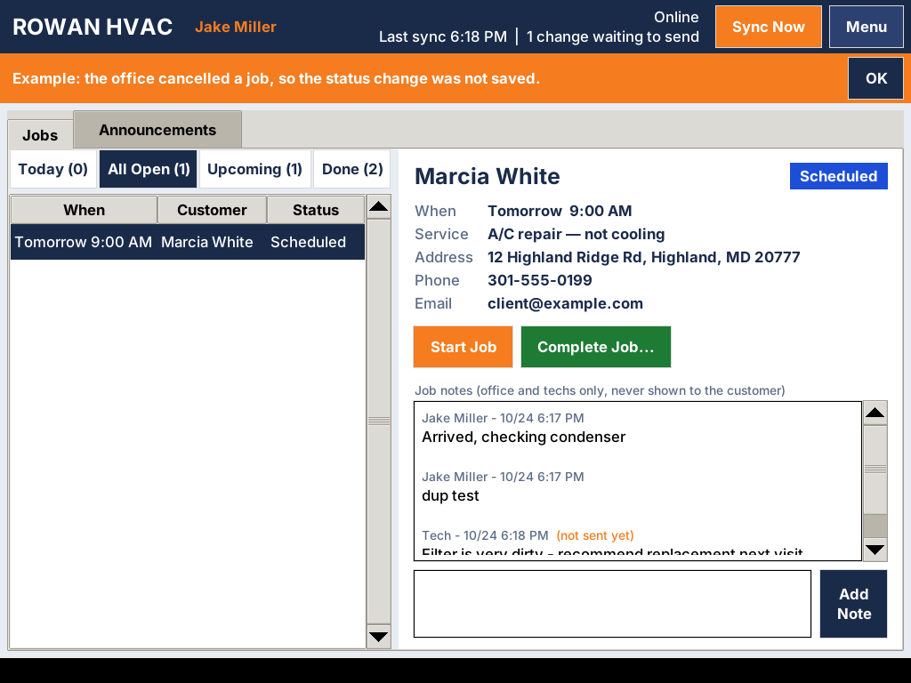

# Rowan Van — desktop app for the van Toughbooks

A desktop app for the technicians' **Panasonic Toughbook CF-29** laptops. It
keeps a local copy of each tech's jobs, so it **works with no signal**, and
syncs with the portal on the Plesk server whenever it can. Every van, plus the
office using the web portal, sees the same jobs, statuses, and notes.



## What a tech can do

- See their jobs: **Today**, **All Open**, **Upcoming**, **Done**
- Open a job: customer, address, phone, email, service needed, appointment time
- **Start Job**, then **Complete Job…** (with the work summary the customer sees
  in their portal history), or go **Back to Scheduled**
- Add **job notes** (internal, never shown to customers)
- Read company **announcements**

Changes save instantly on the laptop. The header shows **Online / OFFLINE**,
when it last synced, and how many changes are still waiting to send. Changes go
up the moment there's a connection (it checks every 60 seconds, or tap
**Sync Now**).

## How sync works

```
 Toughbook (van 1) ─┐                         ┌─ Office (web portal)
 Toughbook (van 2) ─┼──HTTPS──► Plesk server ◄┤
 Toughbook (van 3) ─┘        (portal + MySQL) └─ Clients (web portal)
```

- The **server is the single source of truth.** Vans never talk to each other
  directly. They sync through the portal, so a change from van 1 reaches van 2
  and the office within about a minute.
- Each sync is one small HTTPS request (`POST /api/van/v1/sync`): the van sends
  its queued changes and gets the tech's current jobs back. If nothing changed,
  the reply is a few hundred bytes, which is easy on a cellular plan.
- Every change is safe to resend after a dropped connection; nothing is
  duplicated.
- **Conflicts:** if the office cancels a job while the van was offline, the
  tech's status change for it is refused, and an orange banner tells them why.
  Notes written in the field are always kept.
- Jobs reassigned to another tech disappear from the old tech's van on the next
  sync.

## Install on a CF-29

The CF-29 normally runs **Windows XP**. The app is written for **Python 3.4**
(the last Python that runs on XP), using only Python's standard library, so it
also runs on Windows 7/10 and Linux.

### Windows (XP or newer)

1. Install **Python 3.4.4** (`python-3.4.4.msi` from
   <https://www.python.org/downloads/release/python-344/>). Keep the default
   folder `C:\Python34` and leave **Tcl/Tk** enabled. On Windows 7+ any
   Python 3.4 or newer works.
2. Copy this whole `van-app` folder onto the laptop (USB stick is fine).
3. Double-click `windows\install.bat` (as an administrator). It installs to
   `C:\RowanVan`, adds a **Rowan Van** desktop icon, and makes it start with
   Windows.

### Linux (if you put a lightweight Linux on a Toughbook)

```sh
sh linux/install.sh
```

### First sign-in

Open **Rowan Van** and enter:

- **Portal address**: your portal's URL on the Plesk server, e.g.
  `https://rowanhvacportal.yourdomain.com` (must be `https://`)
- The tech's **portal email and password** (EMPLOYEE or ADMIN accounts only)
- A **van name**, e.g. `Van 3`. This is how the office tells laptops apart.

The van stays signed in. It does not ask for the password every day.

## Office: managing vans

Portal → **Admin → Van Terminals** lists every signed-in laptop with its tech,
last sync time, IP address, and app version.

- **Lost or stolen laptop?** Click **Revoke**. On its next sync, the laptop
  signs out and wipes its local copy of customer data.
- A laptop that hasn't synced for **30 days** is signed out automatically.
- Deactivating a user in the portal also stops their vans from syncing.

## Updating the app

Copy the new `van-app` folder over and run the installer again. The tech stays
signed in, and any unsent changes are kept. They live in `%APPDATA%\RowanVan`
(Windows) or `~/.local/share/rowanvan` (Linux), not in the app folder.

## Troubleshooting

| Problem | Fix |
| --- | --- |
| "Secure connection failed" | Check the laptop's **date and time**. A dead CMOS battery on an old Toughbook resets the clock, which breaks HTTPS. |
| "Can't reach the portal" at sign-in | Check the address and that the van has internet (hotspot / cellular card). |
| Stuck on "OFFLINE" | No connection. Keep working; changes send automatically later. |
| Orange banner | The office changed something that conflicted with an offline change. Read it, tap **OK**. |

## For developers

- Code: `rowanvan/` (`store.py` = local SQLite + outbox, `sync.py` = background
  sync, `api.py` = HTTPS client, `app.py` = Tkinter UI). Entry: `RowanVan.pyw`.
- **Keep it Python 3.4-compatible:** no f-strings, no `async`, no 3.5+ modules.
  Check with `pip install vermin && vermin -t=3.4- --violations rowanvan`.
- Tests: `python -m unittest discover -s tests`
- Point it at a local portal with `http://localhost:3000` (plain http is only
  allowed for localhost). Set `ROWANVAN_HOME` to use a separate data folder.
- Server side: `src/app/api/van/v1/*`, `src/lib/vanSync.ts`, `src/lib/vanServer.ts`.
